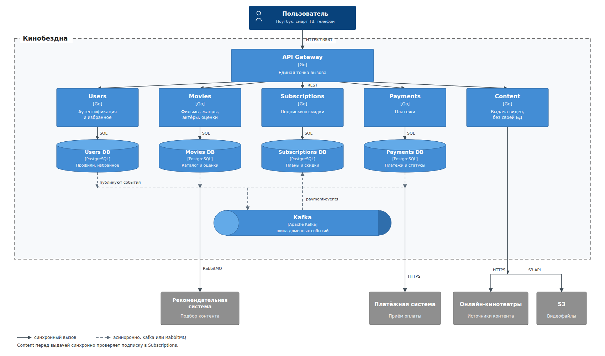

# To-Be: Кинобездна — диаграмма контейнеров (C4)

Целевое состояние после разрезания монолита. Переход к нему — паттерн Strangler Fig: API Gateway постепенно переключает трафик домена на новый сервис. Первым выносится Movies (метаданные). На диаграмме монолита нет.

## Диаграмма

## Домены

| Домен | Что забирает из монолита | Своя БД |
|---|---|---|
| Users | пользователи, аутентификация, папки избранного | да |
| Movies | фильмы, жанры, актёры, оценки | да |
| Subscriptions | подписки, скидки | да |
| Payments | платежи | да |
| Content | выдача видео, связь с кинотеатрами и S3 | нет, состояние в Movies и S3 |

Избранное хранит только идентификаторы фильмов, без внешнего ключа в чужую базу.

## Интеграции

Синхронно ходят только вызовы, на которые пользователь ждёт ответ: клиент в Gateway, Gateway в домен, оплата во внешнюю платёжную систему, выдача видео в кинотеатры и S3, проверка подписки перед воспроизведением.

Всё остальное — события в Kafka. Успешный платёж поднимает или продлевает подписку через `payment-events`, сервисы не вызывают друг друга ради этого.

Рекомендательная система остаётся внешней. Контракт с ней не меняется: Movies по-прежнему отдаёт просмотры и оценки в RabbitMQ. Kafka — внутренняя шина, её наружу не выставляем.

## Чего на диаграмме нет

Kubernetes, Helm, CI/CD и Istio — это способ выкладки, не контейнеры C4. Их закрывают задания 3–5.

Отдельного сервиса «событий» в целевой схеме нет. События публикуют доменные сервисы. Сервис events из задания 2 — проверка гипотезы «Kafka здесь поднимается просто», не домен.
